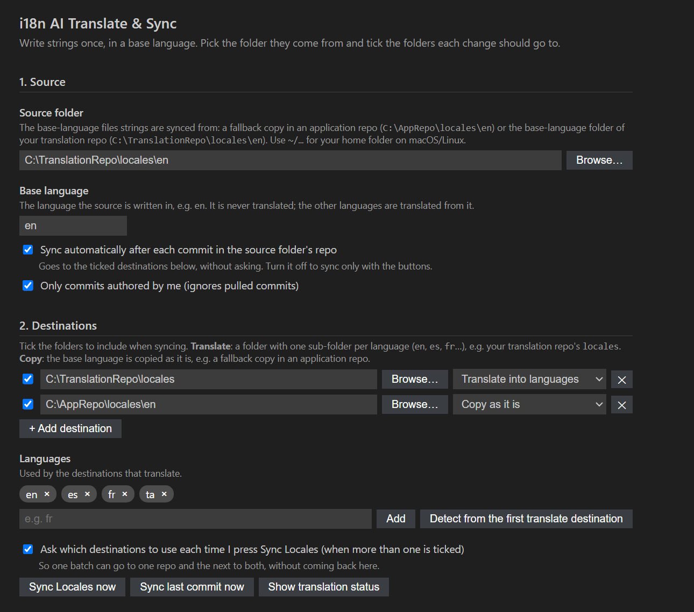
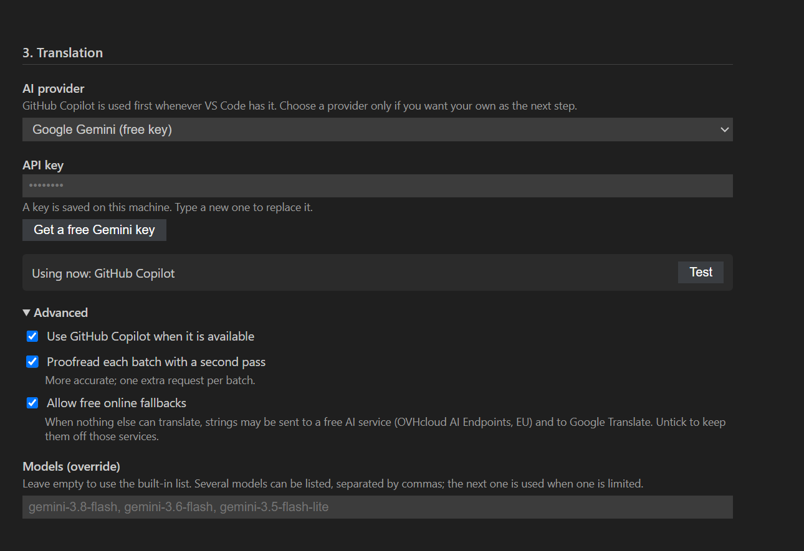
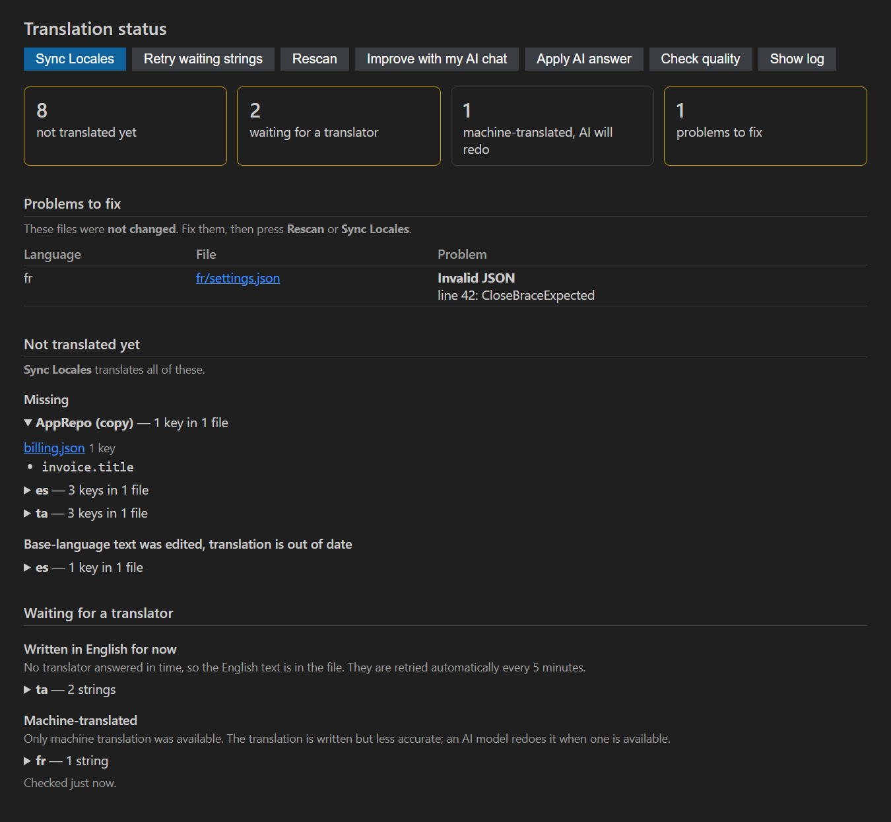

# i18n AI Translate & Sync

Keeps the language folders of a translation repo in step with your strings, and translates new or changed strings with an
**AI model that knows your product** instead of a context-free machine translator.

- **Review-ready translations.** Every request carries the key path of each string, the approved translations already in the
  same file, your glossary and your tone rules. Answers are checked (placeholders, script, untranslated English, approved
  terms) and corrected automatically before they are written.
- **Free, in any editor, no key.** Automatic AI runs on the GitHub Copilot you already have (VS Code) or, in any editor, on a free
  AI service that needs no account (on by default, one checkbox turns it off). Your own Gemini or Groq key, a local Ollama model and a paste-into-any-chat route are there too.
- **One source, destinations you tick.** Pick the folder strings come from and add the folders they go to: a translation repo's
  language folders (translated) and/or another repo's fallback copy (copied as it is). Tick what each sync should include, and
  choose per batch when more than one is ticked.
- **Never loses a string.** If no translator is reachable, the key is still written (English), queued and healed later.

## Screenshots

Settings: one source folder and the destinations you tick (the strings come from one place and go to one or more):



Translation: GitHub Copilot is used first; pick a provider only if you want your own as the next step. One line shows what is in use.



Translation Status: what is not translated yet, what is waiting for a translator, and which files are broken, with buttons to retry.



> Not affiliated with *i18n Ally*. This extension generates and syncs translations; it is not a translation editor.

## Words used here

| Term | Meaning |
|---|---|
| **Base language** | The language strings are written in (usually `en`). Copied as it is, never translated. |
| **Source** | The folder with the base-language files, e.g. a fallback copy in an application repo or `locales/en` of a translation repo. |
| **Destination** | A folder that receives the source. *Translate*: one sub-folder per language (`locales/en`, `locales/fr`, ...), translated. *Copy*: the base language as it is. |

## Quick start

1. Click **i18n Sync: set up** in the status bar (or run **i18n AI Translate & Sync: Configure**).
2. Choose the **source folder** and the **base language**.
3. Add the **destinations** (tick the ones to use), then click **Detect from the first translate destination** for the languages.
4. Click **Test AI translation** once: it shows which engines are available and, in VS Code, asks permission to use Copilot. In editors
   without Copilot it asks whether the free AI service may be used.
5. Optional but recommended: **Create from template** in *Context file* and fill in your glossary. **Save**.

| Setting | Example |
|---|---|
| `i18nSync.source` | `C:/AppRepo/locales/en` or `~/TranslationRepo/locales/en` |
| `i18nSync.destinations` | `[{ "path": "C:/TranslationRepo/locales", "mode": "translate", "enabled": true }, { "path": "C:/AppRepo/locales/en", "mode": "copy", "enabled": true }]` |
| `i18nSync.locales` | `["en","fr","es"]` |
| `i18nSync.sourceLocale` (base language) | `en` |

## What gets synced

**One source, one or more destinations.** Two ordinary set-ups:

| Strings are written in | Source | Destinations |
|---|---|---|
| the application repo (a fallback copy) | that folder | the translation repo's `locales` (*translate*: every language, including the base language, which is copied) |
| the translation repo | its `locales/en` | its `locales` (*translate*: the other languages; the base language is the source itself) and, if you want, the application repo's copy (*copy*) |

A destination row has a folder, a type (*Translate into languages* or *Copy as it is*) and a tick. Only ticked destinations are used.

- **On every commit** (setting *Sync automatically after each commit*): a commit in the source folder's repo is translated and written
  to the ticked destinations, without asking. Added, changed and removed keys are handled; new files are created whole with the
  source file's line endings and indentation; sub-folders are mirrored. Skipped on purpose: merge commits, multi-commit
  fast-forwards, amends, rebases, branch switches and (by default) other people's commits. The source folder's repo must be open in
  VS Code. **Sync Last Commit** runs it for the current commit by hand.
- **With the Sync Locales button** (status bar, the globe icon in the Source Control title bar, or the command): every key that is
  new or edited in the source, or missing from a destination, is brought across. With **more than one ticked destination** it first
  asks which of them this batch should go to (pre-ticked; Esc cancels), so one batch can go to one repo and the next to both without
  opening the settings. *Ask which destinations to use each time* turns that question off.
- **Each destination keeps its own record** of what it was last synced from. Leaving a destination out of one batch never makes it
  miss that batch's edits: it receives them the next time it is included. A copy destination only gets new and edited keys, and never
  has unrelated values overwritten.
- A key already translated from the same text is never translated twice, so committing the same change later does not redo the work.

Nothing is ever committed or pushed in any repo. Review the working tree and commit it yourself.

## How translations are made accurate

For each file and language the extension sends **one batched request** containing:

- the strings, each with its **key path** (`buttons.save` is a button, `errors.*` a message);
- up to 20 **already-approved translations from the same file** closest in the key tree or sharing vocabulary;
- the **glossary entries** that occur in those strings, and names to keep;
- your **product description** and **style rules** per language;
- strict rules: native-quality grammar, placeholders copied exactly, same punctuation and line breaks, no stray English.

Every answer is **validated**; failures go back with the exact problem and are corrected:

| Check | Failure means |
|---|---|
| Placeholders (`{{x}}`, `{x}`, `%s`, `<b>`, `$t()`) | lost, changed or added: rejected |
| Script (Arabic, Tamil, Cyrillic, CJK, ...) | not in the target language's script: rejected |
| Untranslated English | identical or mostly the same words (a model may overrule this for jargon by confirming it) |
| Glossary / kept names | approved word missing (inflected forms are accepted) |
| Punctuation, whitespace, line breaks, length | corrected |

Before any translator is asked, **translation memory** reuses what you have already approved: when exactly the same text
already has a translation in the destination (and the wording is unambiguous), it is reused: free and consistent.

An optional **proofreading pass** sends drafts back to the model for review (on by default; one extra request per batch).

## Which AI is used, in any editor, with no key

The order is fixed, nothing to arrange. The extension uses the first of these that works:

1. **GitHub Copilot**, automatically, when VS Code has it. There is nothing to configure.
2. **Your own provider**, if you chose one on the settings page (*Translation → AI provider*): **Google Gemini** or **Groq** (paste a
   free key), **Ollama** (a model on your computer; the installed models are listed), or **Custom** (any OpenAI-compatible server:
   base URL, model, key). The key is kept in VS Code's secret storage on your machine.
3. **The build's built-in default**, if the build you installed has one (it is never shown).
4. **Free fallbacks** that need no account and no key, on by default (*Advanced → Allow free online fallbacks*):
   a free AI service, [OVHcloud AI Endpoints](https://www.ovhcloud.com/en/public-cloud/ai-endpoints/) (EU), which works in **every
   editor** (VS Code, Cursor, Trae, Antigravity, ...) because it is a plain web request; then **machine translation** (lower
   quality): **Google** first (two endpoints, strings packed into a few requests, paced, your glossary and kept names applied),
   then the Hugging Face Space. Those strings are queued and redone by an AI automatically.

The settings page shows one line, *Using now: ...*, with a **Test** button, so you can see which one is translating.

| | VS Code (+ Copilot) | Cursor, Trae, Antigravity, other forks |
|---|---|---|
| GitHub Copilot | **Yes** | No (not available there; Cursor does not expose its models to extensions; Trae and Antigravity unverified) |
| **Free fallbacks, no key** | **Yes** | **Yes, automatic** |
| Local model (Ollama) | Yes | Yes |
| Your own provider (Gemini, Groq, Ollama, custom; a key from you) | Yes | Yes |
| **Improve with my AI chat** (paste a prompt into any chat AI) | Yes | Yes |
| Translation memory, glossary, validation, both ways of syncing | Yes | Yes |

### What to expect from the free service

- **Quality.** It serves large open models (for example gpt-oss-120b, Qwen3.5-397B, Mistral-Small, Llama-3.3-70B). On the same
  UI strings in Spanish, Slovenian, Arabic and Tamil, their output was far better than the machine translators, and the
  glossary term came out correctly inflected in Tamil. Every answer still goes through the same checks, so a bad one is
  corrected or rejected.
- **Speed.** Anonymous use is limited to **2 requests per minute per model** (per IP). The extension paces itself and rotates
  across models, so a small commit finishes within a minute or two and a large one in several. Models take roughly 5-90 seconds
  per request. Work continues in the background; anything not finished in time is written in English, queued and finished later.
- **Shared networks.** The limit is per IP address, so a whole office behind one address shares it. Give each developer a free key of their own (see
  *A team on one office network* below).
- **Best effort.** It is an anonymous tier that the provider can change or withdraw. If it stops working the extension falls
  back to the next option and queues what is left; the *Improve with my AI chat* route always works.
- **Privacy.** The strings, their key paths and any glossary terms are sent to OVHcloud over HTTPS. Untick *Allow free online
  fallbacks* (Advanced, or `i18nSync.ai.allowFreeFallbacks`) if that is not acceptable for your content.

Other keyless services were tested and not used: Pollinations' anonymous tier is a single small model at one request per 15
seconds and 20-70 seconds per answer, and LLM7's free tier ran out of its daily quota after one request.

### A team on one office network

The built-in free service is limited per **network address** (2 requests per minute per model), and a whole office shares one
address, so it suits individuals, not a team. What scales is a key whose allowance belongs to a *person or project* instead of the
wifi. (GitHub Models, which used to fit this, was retired in July 2026.)

**Recommended when no payment method is possible: one free Gemini key per developer.**

- Each developer creates a free key in Google AI Studio (a Google account, no card, about a minute; the settings screen has a
  **Get a free Gemini key** button), then pastes it into the settings page (*Translation → Google Gemini*). Allowances are per project and per model, so every developer's own key
  has its own allowance: nothing is shared and no key has to be passed around.
- The Gemini choice already lists several models. Each has its own allowance, so the extension moves to the next one when a model
  is rate limited, and leaves one alone for the day once its daily quota is gone (the list can be overridden under *Advanced*).
- To give everybody the same setup without typing it, put an `"ai": { "endpoint": "...", "model": "a, b, c" }` section in the shared
  context file. Never put the key there.
- Things to check yourself: (1) on the free tier **Google may use prompts to improve its products**; (2) the exact free limits are shown
  in your AI Studio account, are not guaranteed and can change; (3) accuracy on *your* strings: run **Check Translation Quality**, which
  scores the engine against translations you have already approved.

| Option | Cost | Limit that matters | Notes |
|---|---|---|---|
| **Gemini free key, one per developer** | free, no card | per project and per model | recommended; see above |
| **GitHub Copilot** in VS Code | already licensed | per developer | no setup; VS Code only |
| Groq free tier | free, no card | per organization: ~30 req/min, 1,000/day, 200,000 tokens/day | fine for a few syncs a day |
| Cerebras free tier | free | per account | its terms forbid sharing a key: one key per person |
| OVHcloud AI Endpoints with a key | pay per token (gpt-oss-120b: $0.09 / $0.47 per million input / output tokens) | 400 requests/min per model per project | needs a payment method; about a tenth of a cent per request |
| Built-in free service (OVH, no key) | free | 2 req/min per model **per network address** | fine alone, too small for 15 people on one wifi |

When a quota runs out, nothing is lost: strings are written with machine translation, queued, and redone with the AI automatically
once it is available again.

### Improve with my AI chat

For when nothing automatic is available (or you prefer a specific chat AI). Strings that only got machine translation are
queued. Run the command, paste the one prompt it copies into any AI chat you already have (Claude, ChatGPT, Gemini, the IDE's own
assistant), copy the whole JSON reply, and run **Apply AI Answer from Clipboard**. The reply goes through the same checks;
anything that fails stays queued and a hand edit is never overwritten. Large queues come in batches of 40 strings.

Free keyless **machine** translators are not accurate enough on their own: they drop sentences, leave strings in English and
pick the wrong sense of a word (for example translating *Save* as "save money"), and Google's unofficial endpoint can be blocked for
a whole network. That is why such results are queued for an AI redo instead of being treated as final.

### Choosing a Copilot model

`i18nSync.ai.copilotModel`: `included` (default; models GitHub normally does not charge as premium requests on paid plans),
`best` (prefers Claude / GPT-5; may use premium requests) or part of a model name such as `claude-sonnet`. Requests are batched
(a handful per commit). Run **Check Translation Quality** to score the engine against translations you already approved.

### Custom server or local model

On the settings page choose *Custom* for any OpenAI-compatible server (base URL, model(s), key: for example
`https://api.groq.com/openai/v1`, `https://openrouter.ai/api/v1`, `https://api.mistral.ai/v1`) or *Ollama* for a model on your
computer (the installed models are listed; the address is under *Advanced* if it is not `127.0.0.1:11434`). The key is kept in
VS Code's secret storage on your machine, one slot per provider. Free tiers and
their limits change; check your provider.

## Context file (glossary, tone, names)

A translator that only sees the English word picks its most common meaning. In a product, words often mean something else: *Board*
may be a page of cards in columns, not a wooden plank, and a *Release* may be a published version of the software, not the
verb "to release". The context
file tells the translator what your words mean here.

**Create Context File from Template** (settings page, step 4, or the command palette) writes `i18n-context.json` and a small JSON
schema next to it for autocomplete. The template is only a convenience: the file is plain JSON, everything in it is optional,
and `{}` is valid. Delete the template's examples once you have your own.

Keep the file in the translation repo so the team shares it: leave the *context file* field empty and every developer's extension
finds `i18n-context.json` in the first *Translate* destination folder on its own.

```json
{
  "appContext": "A web application where teams plan and track their work.",
  "style": {
    "default": "Clear, polite and concise UI wording.",
    "locales": { "es": "Use the formal \"usted\" form." }
  },
  "glossary": [
    {
      "term": "Board",
      "aliases": ["Boards"],
      "meaning": "A page where cards are arranged in columns to track the progress of work, like a kanban board. It is not a wooden board and not a board of directors.",
      "translations": { "es": "tablero" },
      "avoid": { "es": ["junta"] }
    },
    {
      "term": "Release",
      "aliases": ["Releases"],
      "meaning": "A published version of the software, for example version 2.1. It is not the verb \"to release\" (to let go of something)."
    }
  ],
  "doNotTranslate": [
    "ProductName",
    { "term": "CompanyName", "translations": { "ar": "اسم الشركة" } }
  ]
}
```

- **glossary**: one entry per product term. `term` and `aliases` are how it appears in the English strings (list the plural and
  other forms as aliases). `meaning` says in plain words what it means in your product and what it is *not*.
  `translations` is **optional** and per language: give the approved word, in its dictionary form, only where you know it.
  - **With an approved word** for that language, the translator must use it as the core of the phrase, **inflected to fit the
    sentence** (case, number, gender, tense, word order), not pasted in blindly. The result is checked for it.
  - **Without one** (a language you did not list, or no `translations` at all), the translator is told the meaning and must translate
    by that meaning, never word for word, choosing the word a native speaker would use for that concept. This is not checked
    afterwards, so add an approved word for any language where it still gets it wrong.
  - `avoid` is optional too: per language, the wrong-sense words that must not be used for this term, usually the literal translation
    you have seen a translator produce. They go into the prompt as "NEVER use ..." and the result is checked for them. It works with or
    without an approved word.
  - **Everything except `term` is optional, and you only fill in the languages you know.** For example, give the approved word and the
    avoid list for Tamil only: Tamil strings get both, and every other language gets just the `meaning` and translates by it. Nothing of
    the Tamil entry is sent for the other languages.
  - An entry needs at least one of `meaning`, `translations` or `avoid`, or there is nothing to tell the translator and it is
    ignored. (`note` still works as the old name of `meaning`.)
- **doNotTranslate**: names that stay as written; add `translations` to give a spelling per language.
- Only the terms that occur in the strings of a batch are sent, so a long glossary does not make requests bigger. The same context is
  used whichever AI translates (Copilot, your provider, the free service) and by *Improve with my AI chat*.
- The machine-translation fallback (Google) can only substitute approved words and keep names; it cannot use meanings, tone or
  key paths, and the words around a substituted term can come out ungrammatical, so those strings stay queued for an AI redo.

## Reliability

- Machine translation goes to Google first (two endpoints; a blocked one is skipped for a while, requests are packed ~20 strings at a time
  and spaced out). The Hugging Face Space is only woken if Google is blocked, and late answers are ignored.
- Rate limits and outages are retried with backoff. Every file is re-read from disk and each key verified after writing.
- A sync may run for `i18nSync.maxWaitMinutes` (default 5) **plus about 2 seconds per string** (at most 30 minutes), so a big
  first sync gets the time it needs and the setting mostly limits how long a stuck service is waited for. Whatever is not finished by
  then is written in English, queued, and retried every 5 minutes and at startup (**Retry Pending Translations**). A queued string is only replaced if the file still holds exactly
  what was written, so a hand edit is never overwritten.
- If VS Code closes mid-sync, the commit is synced again at the next start (up to three times).
- **A file that is not valid JSON is never written to.** Neither is a key whose place clashes with the base language (a text where
  the base language has a group of keys, or the other way round). They are skipped, the rest of the sync goes on, and they are listed
  on the *Translation Status* page. Once the file is fixed, the next **Sync Locales** fills it.

## Translation Status

**Show Translation Status** (or click the warning in the status bar when something is pending or broken) opens a page with:

- **Problems to fix:** files that are not valid JSON (with the line and the parser's message) and keys whose structure differs from
  the base language. A link opens the file at the right place.
- **Not translated yet:** every key the base language has that a language lacks, and keys whose base-language text was edited since
  they were translated, grouped by language and file. This is a dry run; nothing is written.
- **Waiting for a translator:** strings written in English (or machine-translated) because no good translator answered, per
  language, with a link to each key.

The buttons run **Sync Locales** (translates everything missing), **Retry waiting strings** (only the queued ones), **Rescan**, and
the *Improve with my AI chat* route. The page refreshes by itself when a sync ends.

## Platforms

Pure TypeScript with no native code: it runs on **macOS, Linux and Windows** wherever VS Code (or a fork) runs and `git` is
installed. Folders may be written with `~/` on macOS/Linux. The automated tests run on all three systems in CI
(`.github/workflows/test.yml`); the extension's Windows behaviour is additionally tested inside a real VS Code.

## Privacy: what is sent where

To translate, the extension sends the strings, their key paths, a few approved translations from the same file, the relevant
glossary entries and your product description to the **AI you configured**: GitHub Copilot through VS Code, your endpoint, a local
model, the free AI service (OVHcloud AI Endpoints, only after you allow it), or, with *Improve with my AI chat*, whatever chat you
paste the prompt into. If it falls back to machine translation, individual strings go to Google's public translate endpoint or
the configured Hugging Face Space. Set `i18nSync.ai.enabled` to false to stop using AI, or `i18nSync.ai.allowFreeFallbacks` to
`false` to never use the free fallbacks. Do not use the extension on strings you may not send to these services.

## Commands

| Command | |
|---|---|
| Configure | Settings screen |
| Sync Locales | Sync the source to the ticked destinations (also the status-bar button); asks which when there are several |
| Sync Last Commit | The on-commit sync for the current commit (e.g. after an amend) |
| Improve with My AI Chat / Apply AI Answer from Clipboard | The free, any-editor AI route |
| Test AI Translation | Shows which engines are available; verifies the model and asks Copilot permission |
| Check Translation Quality | Scores the engine against your approved translations |
| Create / Open Context File | Glossary, tone, names |
| Set API Key for a Custom AI Endpoint | Same as typing the key on the settings page, for the chosen provider |
| Show Translation Status | Not translated, broken files, waiting strings, with retry buttons |
| Retry Pending Translations | Heal queued strings now |
| Show Log | The output channel |

## Development

`npm install`, then `F5` to run the extension. `npm test` runs the unit and flow tests; `npm run test:vscode` runs the
integration suite inside a real VS Code (`npm run compile` first). Package with `npx @vscode/vsce package`.

`backend-patch/README.md` describes optional fixes for the Hugging Face Space used as the machine-translation fallback.

## License

MIT
